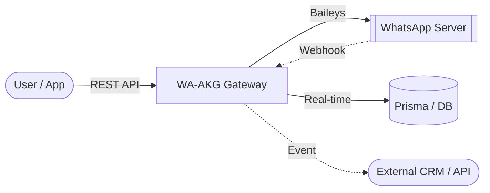

<div align="center">

# 🚀 WA-AKG: The Ultimate WhatsApp Gateway & Dashboard

[](https://wa.me/)
[](https://nextjs.org/)
[](https://www.typescriptlang.org/)
[](https://www.prisma.io/)
[](https://github.com/mrifqidaffaaditya/WA-AKG/releases)
[](https://github.com/mrifqidaffaaditya/WA-AKG)

[](https://api-wa-akg.aikeigroup.net/)

**A professional, multi-session WhatsApp Gateway, Dashboard, and Automation System.**  
Built with **Next.js 16**, **React**, and **Baileys** for high-performance messaging automation and real-time WhatsApp Bot Gateway services.

> [!TIP]
> **Looking for the latest features?** Check out the [beta branch](https://github.com/mrifqidaffaaditya/WA-AKG/tree/beta) or our [pre-releases](https://github.com/mrifqidaffaaditya/WA-AKG/releases) for experimental sources.

[Features](#-key-features) • [User Guide](docs/USER_GUIDE.md) • [API Documentation](docs/API_DOCUMENTATION.md) • [Database Setup](docs/DATABASE_SETUP.md) • [Installation](#-quick-installation)

</div>

---

## 📖 Complete Documentation

WA-AKG comes with extensive documentation designed for both developers and users.

- **[Master Project Documentation](docs/PROJECT_DOCUMENTATION.md)**: Architecture, database, and logic flow.
- **[API Documentation](docs/API_DOCUMENTATION.md)**: Comprehensive OpenAPI / Swagger guide for all **109+ endpoints**.
- **[API Quick Reference](docs/API-QUICK-REFERENCE.md)**: Instantly jumpstart your integration with ready-to-use cURL/JavaScript snippets.
- **[OAuth and MCP authorization](docs/OAUTH.md)**: OAuth clients, user consent, session scopes, and MCP setup.
- **[Environment Variables](docs/ENVIRONMENT_VARIABLES.md)**: Configuration and security guide.
- **[Setup and execution guide](docs/SETUP.md)**: Cross-platform wizard, migration, backups and execution modes.
- **[Reverse proxy under `/wa-akg`](docs/REVERSE_PROXY.md)**: Required path, forwarded headers, static asset and WebSocket behavior.
- **[Internationalization (i18n)](docs/I18N.md)**: How UI languages work and how to add or translate one.

---

## 🌟 Why WA-AKG WhatsApp API Gateway?

WA-AKG transforms your WhatsApp into a fully programmable RESTful API. It's designed for scale, reliability, and ease of use, making it the perfect bridge between your business logic and WhatsApp's global reach. Excellent for developing a **WhatsApp Bot**, Automation, or Customer Service Gateway.

### 🏗️ How it Works



### 🔥 Key Features

- **📱 Multi-Session Management**: Connect and manage unlimited WhatsApp accounts simultaneously via simple QR code scans.
- **⚡ Pro WhatsApp Engine**: Powered by `@whiskeysockets/baileys` for high-speed, stable, and secure WebSocket connections.
- **📅 Advanced Scheduler**: Precise message planning with **Media Support** (Images, Video, Docs).
- **📢 Safe Broadcast**: Built-in anti-ban mechanisms with randomized delays (10-30s) and batch processing.
- **🤖 Smart Auto-Reply**: Keywords matching with **Context Support** (Group/Private/All) and **Media Attachments**.
- **🛡️ Granular Access Control**: Full **Whitelist** & **Blacklist** support for both Bot Commands and Auto Replies.
- **🔗 Enterprise Webhooks**: Robust real-time event forwarding for messages, connections, status changes, and group updates.
- **📇 Advanced Contacts**: Rich contact management with LID, verified names, and profile pictures.
- **🎨 Creative Tools**: Built-in Sticker Maker with background removal (`remove.bg` integration).
- **📘 Open API Spec**: Fully documented via `swagger-ui-react` at `/docs`.
- **🌐 Multi-Language UI**: Dashboard available in English, Bahasa Indonesia and Português (Brasil) with a built-in language switcher ([guide](docs/I18N.md)).

<details>
<summary>📂 <b>View Webhook Payload Example</b></summary>

```json
{
  "event": "message.received",
  "sessionId": "xgj7d9",
  "timestamp": "2026-01-17T05:33:08.545Z",
  "data": {
    "key": { "remoteJid": "6287748687946@s.whatsapp.net", "fromMe": false, "id": "3EB0B78..." },
    "from": "6287748687946@s.whatsapp.net",
    "sender": "100429287395370@lid",
    "remoteJidAlt": "100429287395370@lid",
    "type": "TEXT",
    "content": "saya sedang reply",
    "isGroup": false,
    "quoted": {
      "type": "IMAGE",
      "caption": "Ini caption dari reply",
      "fileUrl": "/media/xgj7d9-A54FD0B6F..."
    }
  }
}
```
</details>

---

## 🧩 Integrations: Native n8n Support

WA-AKG natively supports **n8n**! You can build complex, no-code/low-code WhatsApp automation workflows using our official community nodes.

[](https://www.npmjs.com/package/n8n-nodes-wa-akg)

- **Action Node**: Full control over messaging, groups, sessions, contacts, and labels directly from your n8n workflows.
- **Trigger Node**: Instantly catch real-time webhooks (Message Received, Group Joined, etc.) and trigger your workflows automatically.

👉 **[View on npm (n8n-nodes-wa-akg)](https://www.npmjs.com/package/n8n-nodes-wa-akg)**

---

## 🚀 Quick Installation

### 1. Prerequisites
- Node.js 20+ (Node.js 22 recommended)
- MySQL or PostgreSQL, unless using the Docker Compose database
- Git (for installation and updates)
- Docker Desktop or Docker Engine + Compose, only for Docker mode

### 2. Setup with the cross-platform wizard
```bash
# Clone and install
git clone https://github.com/mrifqidaffaaditya/WA-AKG.git
cd WA-AKG
npm install

# Configure a new instance, or migrate/review an existing configuration
npm run setup
```

The wizard works from Windows PowerShell/Command Prompt, Linux and macOS. On a first run it creates the local configuration interactively. On later runs it detects the existing configuration and offers to keep it, reconfigure it, or cancel. When the format is from an older version, it creates a timestamped backup before applying a preserving migration. It does not print secret values.

After setup, create the initial administrator only when needed:

```bash
npm run make-admin admin@example.com
```

See [Setup and execution guide](docs/SETUP.md) for platform-specific commands, migration recovery and security limits.

### 3. Run (Development)
```bash
npm run dev
```

### 4. Run in production
The portable production wizard validates the environment, asks for the binding, confirms the database migration, runs the migration and build, and only then starts the server:

```bash
node scripts/setup.mjs --mode=production
```

For non-interactive automation, migration authorization must be explicit:

```bash
node scripts/setup.mjs --mode=production --non-interactive --apply-migrations
```

The default binding should be `127.0.0.1`; use a TLS reverse proxy for external access. Before production migration, back up the database and verify the target. The wizard stops on migration, port or build errors and does not install a process supervisor.

The individual commands remain available when the operational procedure requires them:

```bash
npm run build
npm start
```

Use a process supervisor such as PM2, systemd, Windows Service Manager or launchd only if it is already part of your operational environment; the wizard does not install or configure global services.

---

### 🐋 Alternative: Docker Deployment
Docker Compose is an alternative execution mode:

1. **Prepare Environment**:
   ```bash
   cp .env.example .env
   ```
   Set `MYSQL_ROOT_PASSWORD`, `MYSQL_APP_PASSWORD`, `AUTH_SECRET`, `SWAGGER_PASSWORD`, and the other required settings. The app uses the dedicated MySQL application account, not `root`.

2. **Build and apply schema migrations explicitly**:
   ```bash
   docker compose build app
   docker compose --profile ops run --rm migrate
   ```
   New databases apply the migration chain in this step. For an existing database, back it up and verify its current schema against the exact migration before baselining: set `PRISMA_BASELINE_MIGRATION` to that migration ID and run `docker compose --profile ops run --rm baseline`. Only mark migrations already represented by the database as applied; then run `migrate` to apply later migrations.

3. **Start the app and database**:
   ```bash
   docker compose up -d db app
   ```
   The app port binds to `127.0.0.1` by default. Put a reverse proxy in front for remote access. Schema migration and admin creation do not run on app startup. To create/promote the initial admin, set `ADMIN_EMAIL` and `ADMIN_PASSWORD` in `.env` and run `docker compose --profile ops run --rm admin-setup` once.

---

## 📚 API Reference Overview

WA-AKG provides a comprehensive REST API to integrate WhatsApp Messaging directly into your applications. Full details in [API_DOCUMENTATION.md](docs/API_DOCUMENTATION.md).

> [!TIP]
> Use the built-in **Swagger UI** for interactive exploration at `/docs`.

| Method | Endpoint | Description |
| :--- | :--- | :--- |
| `POST` | `/api/messages/{sessionId}/{jid}/send` | Send text, media, or stickers |
| `POST` | `/api/messages/{sessionId}/broadcast` | Scalable bulk messaging |
| `PATCH` | `/api/sessions/{id}/settings` | Update session configuration |
| `GET` | `/api/groups/{sessionId}` | List all available groups |
| `POST` | `/api/webhooks/{sessionId}` | Register real-time event listeners |
| `POST` | `/api/autoreplies/{sessionId}` | Create context-aware auto-replies |
| `POST` | `/api/auth/register` | Register new users via the web securely |

### Example: Send Text Message
```bash
curl -X POST http://localhost:3000/api/messages/session_01/62812345678@s.whatsapp.net/send \
  -H "X-API-Key: your_api_key" \
  -H "Content-Type: application/json" \
  -d '{
    "message": { "text": "Hello from WA-AKG!" }
  }'
```

---

## ⚠️ Known Issues / Caveats

> [!WARNING]
> **Status Update Feature (POST `/api/status/update`)**
> 
> The WhatsApp status/story update feature is currently **experiencing known issues** and should be avoided in production:
> - Text statuses with custom background colors may not display correctly
> - Media statuses (images/videos) may fail to upload to WhatsApp servers
> - The feature is under active development
> 
> We recommend waiting for the next release before using this endpoint in critical workflows.

---

## 🛡️ Security
- **API Key Auth**: Secured endpoints using `X-API-Key` header.
- **RBAC**: Multi-role support (`SUPERADMIN`, `STAFF`, `USER`).
- **Encrypted Passwords**: All passwords hashed with bcrypt.
- **JWT Encryption**: Session tokens signed with `AUTH_SECRET` (wajib diisi — tidak ada fallback).
- **Input Validation**: Zod schemas on critical endpoints.
- **Media Protection**: Path traversal prevention, session-scoped media access.

---

<div align="center">
  Built with ❤️ by <a href="https://github.com/mrifqidaffaaditya">Aditya</a>  
  Licensed under <a href="LICENSE">MIT</a>
</div>


## Optional MCP integration

WA-AKG includes an optional Model Context Protocol (MCP) add-on under `mcp/wa-akg-mcp`. The recommended HTTP transport is mounted on the same WA-AKG HTTP server at `/mcp`; it is disabled by default and does not replace the existing API or WhatsApp runtime. When `WA_AKG_MCP_ENABLED` is not exactly `true`, regular startup behavior is unchanged. Standalone stdio mode is also available.

Install and validate the optional module:

```powershell
npm run mcp:install
npm run mcp:check
npm run mcp:test
```

Start the MCP server separately when an MCP client needs it:

```powershell
npm run mcp:start
```

To enable HTTP MCP, configure `OAUTH_ISSUER_URL` and `WA_AKG_MCP_ENABLED=true`, then create an OAuth client in **Dashboard → OAuth Access**. MCP clients use OAuth user delegation; no static HTTP bearer token is configured. The endpoint is served by the same process and port as the app, normally `https://your-domain/mcp`. Configure `WA_AKG_API_BASE_URL` for tool calls. Write operations require both the user's `mcp:write` grant and an exact `WA_AKG_MCP_WRITE_ALLOWLIST` entry. See [OAuth and MCP authorization](docs/OAUTH.md) and `mcp/wa-akg-mcp/README.md` for details.
