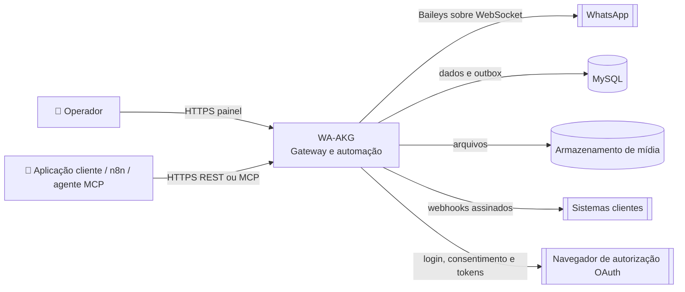
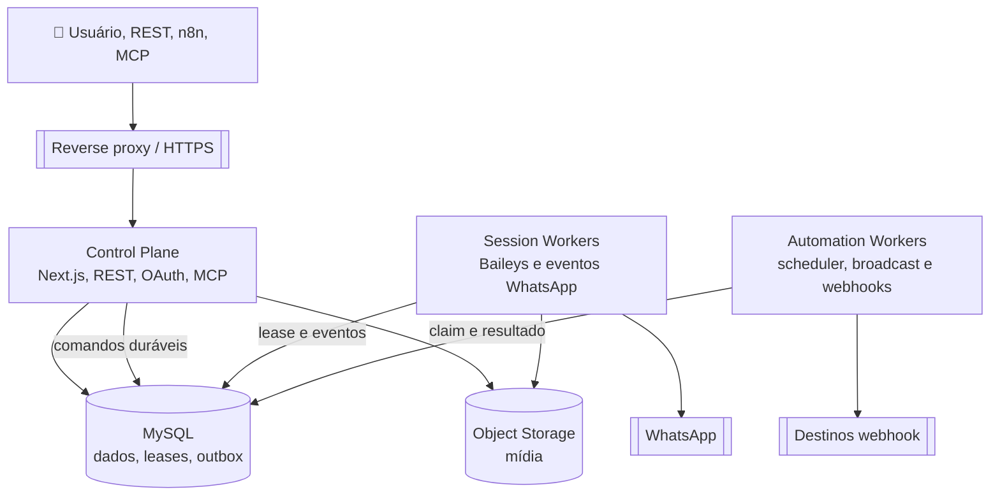
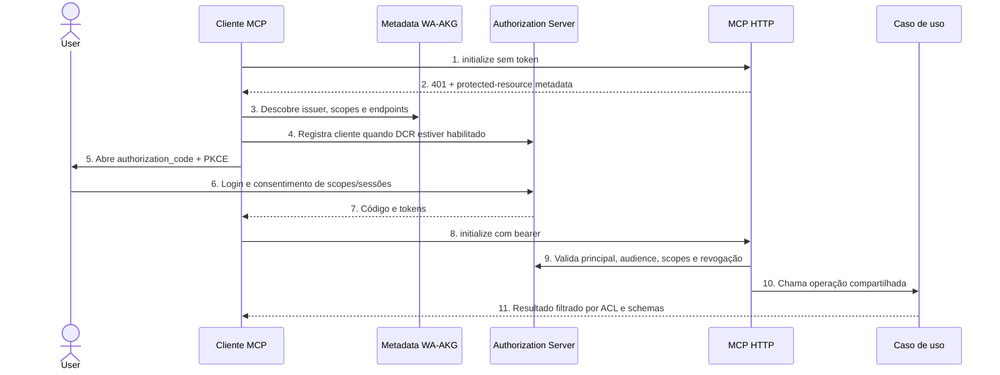

# Replanejamento de Arquitetura do WA-AKG

> **Estado:** PROPOSED — arquitetura alvo para revisão, ainda não aprovada nem implementada.
> **Baseline observado:** branch main, HEAD aa52dcccf262b238ecba0eac010d0cc23c7f2579.
> **Escopo:** painel, API, OAuth, MCP, sessões WhatsApp, automações, webhooks, dados e operação.
> **Data:** 2026-10-26

## Resumo executivo

O WA-AKG deve evoluir de uma aplicação concentrada em um processo para um **monorepo modular com três papéis de execução**: plano de controle HTTP, workers de sessão WhatsApp e workers de automação/entrega. REST, painel e MCP devem chamar os mesmos casos de uso e políticas de autorização. Efeitos externos passam a ser persistidos antes da execução, com outbox, idempotência, tentativas limitadas e estados recuperáveis.

Esta proposta não começa com microserviços independentes. Mantém TypeScript, Next.js, Prisma e MySQL, que são o stack real observado, mas cria limites internos e processos isoláveis. Só adiciona broker, Redis ou serviços separados quando métricas demonstrarem necessidade. Migrações de banco são aditivas e compatíveis com versões em execução.

Este documento distingue **OBSERVED** (confirmado no código/configuração), **DECLARED** (documentação/produto), **INFERRED** (interpretação) e **RECOMMENDED** (estado proposto). A documentação antiga é contexto, não prova do runtime atual.

## 1. Introdução e objetivos

### Necessidades do produto

| ID | Necessidade | Origem/evidência | Prioridade | Aceitação proposta |
|---|---|---|---|---|
| R-01 | Gerenciar várias conexões WhatsApp com ciclo de vida observável. | DECLARED: README; OBSERVED: Session, AuthState e WhatsAppManager. | P0 | Uma sessão tem um único worker proprietário; iniciar, parar e reconectar produzem transições persistidas e auditáveis. |
| R-02 | Expor operações por painel, REST e MCP sem duplicar regras de negócio. | OBSERVED: Next.js App Router, 96 arquivos route.ts e add-on MCP. | P0 | Cada operação mutável passa por um caso de uso compartilhado e pela mesma autorização. |
| R-03 | Aplicar autorização por usuário, papel e sessão em toda interface. | OBSERVED: User, Role, SessionAccess, api-auth e session-access. | P0 | Testes negativos demonstram negação de token ausente, escopo insuficiente, usuário sem acesso e sessão fora do escopo OAuth. |
| R-04 | Evitar perda e duplicação de mensagens, tarefas e webhooks em falhas. | OBSERVED: Scheduler, Broadcast e campos de claim; INFERRED: execução distribuída pode repetir trabalho. | P0 | Comandos persistidos sobrevivem a restart; repetir a mesma chave de idempotência não cria segundo envio. Resultados externos ambíguos não são reenviados automaticamente. |
| R-05 | Manter integrações externas isoladas, limitadas e diagnosticáveis. | OBSERVED: MCP, webhooks, Baileys e APIs externas. | P1 | Timeout, retry, limite de tamanho, assinatura, deduplicação e classificação de falha são definidos por integração. |
| R-06 | Evoluir sem perda de dados nem interrupção desnecessária das sessões. | DECLARED: suporte a dados persistentes e múltiplas sessões; AGENTS.md: migrações incrementais. | P0 | Cada mudança de schema tem plano expand/contract, compatibilidade de versões e rollback operacional. |

### Escopo e fora de escopo

Inclui o sistema completo de gateway e painel. Não define metas de volume, disponibilidade contratual, política comercial, retenção legal ou composição de equipes; esses dados não foram encontrados e permanecem decisões pendentes.

## 2. Restrições e evidências

### Estado atual observado

| Evidência | Observação |
|---|---|
| [package.json](../package.json) | v1.7.0; Next.js 16.1.1, React 19, TypeScript, Prisma, Baileys e Socket.IO. Scripts principais: build, start, lint, test, mcp:check e mcp:test. |
| [src/server/index.ts](../src/server/index.ts) | Um custom server prepara Next, conecta Prisma, monta MCP opcional, Socket.IO, WhatsAppManager e scheduler no mesmo processo. O carregamento inicial restaura sessões com credenciais. |
| [src/app/api](../src/app/api) | 96 arquivos route.ts. Uma varredura mecânica encontrou Prisma direto em 42, uso de auth em 88 e helpers de acesso à sessão em 72. São indícios de acoplamento/cobertura, não uma auditoria de autorização. |
| [src/modules/whatsapp](../src/modules/whatsapp) | Baileys, instâncias, manager, armazenamento de contatos/grupos/autoresposta e scheduler estão sob um único módulo. Instâncias ativas e Socket.IO são mantidos em memória de processo. |
| [prisma/schema.prisma](../prisma/schema.prisma) | 27 modelos. O provider declarado é MySQL; Session.status é String. O schema inclui mensagens, estado de autenticação, automação, webhooks, compartilhamento de sessão, OAuth e leases/claims. |
| [prisma/migrations](../prisma/migrations) | Há baseline e migração incremental para OAuth e worker leases. Docker Compose possui MySQL e app; migrate é um perfil operacional separado. |
| [mcp/wa-akg-mcp](../mcp/wa-akg-mcp) | O HTTP MCP é montado no custom server, autentica bearer OAuth, limita corpos a 1 MiB, valida identidade por userinfo e tem sessões de transporte em memória com TTL. Stdio é outro modo. |
| [docs/PROJECT_DOCUMENTATION.md](PROJECT_DOCUMENTATION.md) | Declara versão 1.6.1, 86 rotas e sincronização de schema no startup. Diverge do package/schema e do entrypoint atuais; precisa ser substituída ou marcada como histórico. |
| Worktree | Há mudanças locais em OAuth/DCR, configuração e testes MCP, scripts de startup e package scripts. Não são tratadas como decisões aprovadas; devem ser preservadas durante o plano. |

### Restrições de desenho

- Preservar dados existentes e migrar sem reset, db push destrutivo ou alteração de compatibilidade implícita.
- Usar autenticação e autorização no backend; middleware e UI não são fronteiras suficientes.
- Não expor tokens, chaves, QR codes ou credenciais WhatsApp em logs.
- Tratar chamadas a WhatsApp, webhooks e APIs externas como efeitos não transacionais e sujeitos a timeout/resultado ambíguo.
- Manter MySQL como banco canônico inicial. PostgreSQL é citado em documentação, mas não é o provider Prisma observado.
- Manter API e clientes atuais compatíveis durante a migração; versionamento e sunset precisam de uma política explícita.

## 3. Contexto e limites do sistema

### C4 — contexto alvo



| Sistema externo | Interface | Responsabilidade/limite |
|---|---|---|
| WhatsApp | Baileys/WebSocket | Transporte de mensagens e eventos. Não oferece transação com o banco WA-AKG nem garante exatamente uma entrega por chamada. |
| Clientes REST e n8n | HTTPS/OpenAPI | Integração pública; compatibilidade, autorização e limites pertencem ao WA-AKG. |
| Clientes MCP | Streamable HTTP ou stdio local | Chamam ferramentas do mesmo catálogo de casos de uso. HTTP exige OAuth; escrita fica desativada por padrão. |
| Destinos de webhook | HTTPS | Recebem eventos com assinatura HMAC, deduplicação e retry limitado. URLs são entrada não confiável e precisam de defesa contra SSRF. |
| MySQL | Prisma | Fonte canônica de usuários, sessões, mensagens, tarefas, permissões e concessões OAuth. |
| Armazenamento de objetos | API interna de mídia | Guarda arquivos; o banco mantém metadados e referências, não payload binário crescente. |

O WA-AKG é responsável por identidade local, autorização, ownership das sessões, persistência, ordenação de comandos e tentativas de integração. WhatsApp permanece autoridade sobre o estado remoto da conta e resultado final de cada operação de rede.

## 4. Estratégia de solução

1. **Monorepo modular, não big-bang de microserviços.** Manter contratos e módulos de domínio em uma base; separar processos para isolar estado e ciclo de vida.
2. **Adaptadores finos.** Next route handlers, REST, OAuth e MCP validam protocolo e chamam casos de uso; não implementam SQL ou políticas paralelas.
3. **Persistir antes de efeitos externos.** Comandos de envio, jobs e eventos entram em registros duráveis antes de workers chamarem Baileys/webhooks.
4. **Ownership explícito.** Uma sessão WhatsApp pertence a um worker por lease renovável e fencing token. API e workers não abrem conexões concorrentes para a mesma sessão.
5. **MySQL e Prisma continuam inicialmente.** Adotar transações, índices e migrations versionadas. Introduzir broker dedicado só quando throughput, latência ou isolamento operacional justificarem o custo.
6. **Semântica honesta de entrega.** A API confirma aceitação durável, não entrega remota. Resultado incerto fica em estado UNKNOWN para reconciliação, evitando retry cego que duplique mensagens.
7. **Um contrato de autorização.** Sessão do painel, API key e OAuth convergem para principal, scopes, role e autorização por sessão. API keys existentes migram de forma compatível para armazenamento por hash.

## 5. Visão de blocos

### C4 — containers alvo



### Organização proposta no monorepo

    apps/
      control-plane/       # Next.js: painel, REST, OAuth e transporte MCP
      session-worker/      # dono das conexões Baileys, sem páginas HTTP
      automation-worker/   # scheduler, broadcasts e entrega de webhooks
    packages/
      domain/              # regras e entidades por domínio, sem Next/Prisma
      application/         # comandos, queries, policies e ports
      persistence/         # Prisma, migrations, repositories e outbox
      contracts/           # OpenAPI, eventos, schemas MCP e tipos compartilhados
      whatsapp-baileys/    # adapter isolado para Baileys
      observability/       # logger redigido, métricas, tracing e correlação

Domínios: Identity & Access; WhatsApp Session; Messaging; Contacts & Groups; Automation; Webhook Delivery; Integrations (REST/MCP); Media; Operations. Cada domínio tem invariantes, comandos/queries e ownership explícitos. A estrutura física é introduzida por extração incremental; não mover 96 rotas em uma única mudança.

### Ownership de dados

| Dados | Dono lógico | Regra |
|---|---|---|
| Usuário, role, API key, clientes e concessões OAuth | Identity & Access | Só o módulo de identidade grava; tokens e chaves persistem por hash sempre que usados como bearer. |
| Sessão, ACL e lease do worker | WhatsApp Session | SessionAccess é autorização por relação; sessão não é inferida pelo cliente que envia a requisição. |
| AuthState Baileys | WhatsApp Session | Segredo de alta sensibilidade; criptografia gerenciada por chave externa e rotação planejada. |
| Mensagens, contatos e grupos | Messaging / WhatsApp Session | Preservar chave remota para dedupe e índices por sessão/tempo; evitar payload bruto sem finalidade. |
| Agendamentos, broadcasts e tentativas | Automation | Estado durável, claims com lease e tentativa, idempotência por operação. |
| Eventos e tentativas de webhook | Webhook Delivery | Outbox, assinatura por entrega, política de retenção e redaction. |
| Binários e derivados | Media | Object storage com URL assinada curta; banco guarda owner, checksum, tipo, tamanho e expiração. |

O modelo atual não tem conceito confirmado de organização/equipe. Na primeira evolução, User segue sendo principal e SessionAccess define compartilhamento. Workspace só entra após decidir se usuários pertencem a equipes e como dados/cobrança são isolados.

## 6. Visões de runtime e fluxos

### Abrir sessão WhatsApp

```mermaid
sequenceDiagram
    actor User
    participant API as Control Plane
    participant DB as MySQL
    participant Worker as Session Worker
    participant WA as WhatsApp

    User->>API: 1. Solicita iniciar sessão
    API->>API: 2. Autentica e autoriza owner/SessionAccess
    API->>DB: 3. Persiste comando e estado QUEUED
    Worker->>DB: 4. Reclama comando e lease exclusivo
    Worker->>WA: 5. Abre transporte Baileys
    WA-->>Worker: 6. QR, conexão ou falha
    Worker->>DB: 7. Persiste transição e checkpoint
    Worker-->>API: 8. Publica atualização correlacionada
    API-->>User: 9. Mostra estado; QR só ao usuário autorizado
```

### Enviar mensagem e entregar evento

```mermaid
sequenceDiagram
    actor Client
    participant API as REST/MCP
    participant DB as MySQL + Outbox
    participant Worker as Session Worker
    participant WA as WhatsApp
    participant Hook as Webhook Worker

    Client->>API: 1. POST com chave de idempotência
    API->>API: 2. Valida schema, escopo e ACL da sessão
    API->>DB: 3. Grava comando + outbox na mesma transação
    API-->>Client: 4. 202 Accepted + operationId
    Worker->>DB: 5. Reclama comando com lease
    Worker->>WA: 6. Envia respeitando throttle
    WA-->>Worker: 7. Retorna ack ou resultado incerto
    Worker->>DB: 8. Grava estado e eventos de saída
    Hook->>DB: 9. Reclama evento pendente
    Hook->>Client: 10. POST assinado; retry limitado
    Hook->>DB: 11. Grava entrega ou agenda próxima tentativa
```

### Autorização OAuth para MCP



O passo 4 só existe se DCR estiver aprovado e limitado. O código de DCR está presente em mudanças locais, mas ainda não é decisão confirmada. A alternativa é cadastro administrativo com redirect URI exato.

### Falhas e recuperação

- **Worker cai antes de enviar:** lease expira e outro worker reprocessa comando não iniciado.
- **Worker cai após enviar e antes de persistir ack:** resultado é ambíguo. Registrar UNKNOWN; não assumir falha e repetir automaticamente.
- **Webhook indisponível:** retentar com exponential backoff limitado, jitter, circuit breaker por destino e fila de falhas para intervenção.
- **Banco indisponível:** readiness fica negativa; API não aceita operações que prometam durabilidade; workers param de reclamar novos itens.
- **OAuth revogado:** próxima requisição falha antes do caso de uso; sessão MCP em memória é encerrada ou revalidada.
- **Processo encerrando:** parar novos claims, completar janela de drain, soltar leases e fechar socket WhatsApp sem apagar credenciais persistidas.

## 7. Visão de deployment

| Unidade | Réplicas iniciais | Estado local permitido | Dependências |
|---|---:|---|---|
| Control Plane | 1; escalar após Socket.IO/pubsub estar compartilhado | cache curto e sessões MCP transitórias | MySQL, object storage, reverse proxy |
| Session Worker | 1 inicialmente; depois N com lease/fencing por sessão | sockets Baileys e cache de conexão sob lease | MySQL, WhatsApp, object storage |
| Automation Worker | 1 inicialmente; depois N por claim | nenhum estado de negócio exclusivo em memória | MySQL, destinos webhook |
| Migrator/ops | execução única por release | nenhuma | MySQL |
| MySQL | serviço gerenciado ou container operado | storage durável e backups validados | backups fora do host |
| Object Storage | serviço compatível S3 | não aplicável | URLs assinadas, criptografia e lifecycle |

O reverse proxy termina TLS, preserva Host e encaminha base path corretamente. Portas internas ficam privadas. Cada processo implementa liveness, readiness e shutdown gracioso. Deploy aplica migration aditiva antes da aplicação; rollback é por versão enquanto o schema permanece compatível.

MySQL 8.0 permanece opção inicial porque é o provider observado e o Compose existente usa MySQL. O deployment atual não prova prontidão para múltiplas réplicas: sessões MCP, WhatsApp, Socket.IO e scheduler têm estado em memória ou claims ainda concentrados no processo. Não escalar essas unidades até os gates de lease, evento e coordenação passarem.

## 8. Conceitos transversais

### Segurança e autorização

- Produzir um principal canônico com userId, role, authMethod, scopes e sessionScope em um único serviço de autenticação.
- Aplicar política no caso de uso, não apenas no handler. SUPERADMIN, owner, SessionAccess, scopes OAuth e escopo de sessões são verificações independentes.
- Diferenciar 401 (identidade ausente/inválida) e 403 (identidade válida sem permissão); limitar respostas para não confirmar recursos fora do tenant.
- API keys são bearer secrets. A coluna atual User.apiKey e busca por valor direto pedem migração para prefixo público + hash criptográfico, comparação segura e rotação com período de compatibilidade.
- Tokens OAuth, client secrets, segredo de webhook, API keys de terceiros e credenciais Baileys são segredos distintos, com armazenamento, redaction, expiração e rotação documentados.
- DCR deve exigir limites de payload, rate limit, redirect URI validado, client revogável e consentimento explícito. DCR não concede acesso sozinho.
- Ferramentas MCP ficam read-only por padrão; cada escrita exige mcp:write, scope da API, role, autorização de sessão e allowlist exata. Broadcast, envio e alteração de credenciais são operações de alto risco.
- Webhooks usam assinatura HMAC, timeout, limite de resposta, redirects desativados e bloqueio de IPs privados/link-local. Resolver e validar DNS em cada tentativa reduz SSRF/rebinding.

### Consistência, idempotência e ordenação

- Chaves remotas do WhatsApp deduplicam mensagens inbound; constraints de banco, não checks em memória, são a última barreira.
- Comandos outbound têm idempotencyKey única por principal/operação. A mesma chave retorna o mesmo operationId.
- Cada sessão serializa operações incompatíveis e tem limite de envio próprio; workers validam lease e fencing token antes de side effects.
- A transação de negócio grava entidade e outbox. O publicador pode repetir, portanto consumidores também deduplicam.
- Retry automático só ocorre quando a operação é comprovadamente segura ou ainda não começou; resultado externo ambíguo exige reconciliação.

### Eventos, webhooks e automações

- Eventos internos têm envelope versionado: eventId, type, version, occurredAt, tenant/session, correlationId e payload mínimo.
- Automação, scheduler e broadcast são consumidores de jobs duráveis e observáveis com estado, tentativas, próxima execução, cancelamento e erro classificado.
- Webhook guarda metadados de entrega e corpo mínimo necessário. Logs não armazenam headers de autenticação, tokens nem payload completo por padrão.
- Limites de concorrência, tentativas e taxa são configuráveis por sessão/integração. Circuit breaker evita repetição agressiva contra destinos indisponíveis.

### Observabilidade e privacidade

- Log estruturado com requestId, operationId, eventId, sessionId pseudonimizado e workerId; sem números de telefone completos, mensagem, QR ou bearer token.
- Métricas: estado/idade da lease, conexão por sessão, idade da outbox, backlog/lag, entregas e retries, latência externa, mensagens UNKNOWN, refresh/revogação OAuth e negações de ACL.
- Traces atravessam handler → caso de uso → banco/outbox → worker → provedor; credenciais e conteúdo pessoal são atributos proibidos.
- Definir retenção por classe: logs, mensagens, mídia, auth state, grants e auditoria. Exclusão percorre cópias e objetos de mídia.

## 9. Decisões arquiteturais propostas (ADRs)

### ADR-001: Monorepo modular com três papéis de execução

- **Estado:** proposed.
- **Contexto:** o processo atual concentra Next, REST, Socket.IO, Baileys, MCP e scheduler.
- **Decisão:** manter um repositório e módulos compartilhados; publicar control plane, session worker e automation worker como processos isoláveis.
- **Consequências:** separa falhas e escala por tipo; exige contratos internos, lifecycle e teste de compatibilidade.

### ADR-002: MySQL canônico e outbox durável antes de broker

- **Estado:** proposed.
- **Contexto:** Prisma declara MySQL e Compose opera MySQL; já existem campos de claim/lease.
- **Decisão:** preservar MySQL e introduzir transactional outbox/job tables com índices e claims atômicos. Medir antes de adicionar Redis/RabbitMQ/SQS.
- **Consequências:** menor custo operacional e consistência transacional; DB absorve carga de fila até capacidade ser medida.

### ADR-003: Um worker proprietário por sessão WhatsApp

- **Estado:** proposed.
- **Contexto:** Baileys mantém conexão em memória e restaura sessões no processo inicial.
- **Decisão:** lease exclusiva renovável, fencing token, backoff e handoff/drain de sessão.
- **Consequências:** evita sockets concorrentes e permite distribuição; failover não é instantâneo e precisa de política de lease/reconnect.

### ADR-004: Casos de uso comuns e política única de autorização

- **Estado:** proposed.
- **Contexto:** REST, painel, API key e OAuth/MCP chegam a handlers distintos; parte dos handlers acessa Prisma diretamente.
- **Decisão:** adapters chamam application services que exigem principal e autorização. Token/scope/sessionAccess são verificados em cada chamada.
- **Consequências:** regras ficam testáveis e coerentes; migração de rotas é incremental e precisa de testes de regressão.

### ADR-005: Entrega assíncrona com idempotência e UNKNOWN

- **Estado:** proposed.
- **Contexto:** banco e WhatsApp/webhook não compartilham transação; crashes criam resultado ambíguo.
- **Decisão:** API aceita comando durável, worker executa e grava resultado. Chaves idempotentes evitam submissão repetida; resultado ambíguo não provoca retry cego.
- **Consequências:** API pode responder 202 antes da entrega; clientes precisam consultar/receber estado e o produto precisa expor reconciliação.

### ADR-006: OAuth delegada como autenticação HTTP MCP

- **Estado:** proposed.
- **Contexto:** servidor HTTP protegido precisa atuar em nome do usuário e respeitar ACL por sessão.
- **Decisão:** Authorization Code + PKCE, resource metadata, audience validada, scopes mínimos, rotação de refresh token e consentimento; escrita opt-in. Definir separadamente se registro de cliente será administrativo ou DCR restrito.
- **Consequências:** consentimento é mais seguro e auditável; onboarding depende de callback correto, issuer canônico e cliente MCP compatível.

## 10. Requisitos de qualidade e verificação

| ID | Cenário mensurável | Critério | Estado |
|---|---|---|---|
| Q-01 | Mesmo pedido outbound repetido com a mesma chave. | Zero segundo side effect; mesma operação retornada. | RECOMMENDED; falta implementação/verificação ponta a ponta. |
| Q-02 | Usuário tenta acessar sessão alheia ou fora de sessionScope OAuth. | 100% das rotas e ferramentas negam; nenhum dado lateral revelado. | UNKNOWN; mapa de handlers é parcial. |
| Q-03 | Worker cai depois do commit da mensagem inbound. | Nenhum evento confirmado no banco se perde; consumidor deduplica replay. | RECOMMENDED; outbox ainda precisa ser desenhada/implementada. |
| Q-04 | WhatsApp aceita envio e processo cai antes de gravar ack. | Estado UNKNOWN recuperável, sem retry automático que duplique. | RECOMMENDED; contrato de status e reconciliação pendente. |
| Q-05 | Destino webhook aponta para IP privado ou muda DNS para rede interna. | Zero conexão a IP bloqueado, inclusive após redirect/resolução nova. | UNKNOWN; ameaça precisa de suíte adversarial. |
| Q-06 | Aumenta carga de mensagens e sessões. | p95 API, atraso da fila e reconnect dentro de limites aprovados. | UNKNOWN; não há baseline nem metas de volume/SLO. |
| Q-07 | Deploy introduz alteração de schema com versão antiga ainda ativa. | Release e rollback não perdem nem reinterpretam dados. | RECOMMENDED; exige teste de compatibilidade expand/contract. |
| Q-08 | MCP chama ferramenta de escrita com token apenas mcp:read. | Requisição negada e nenhum efeito externo. | RECOMMENDED; adicionar teste de protocolo end-to-end. |

Antes de escolher p95, disponibilidade, RTO/RPO e capacidade máxima, coletar baseline real em carga representativa. Não converter estes cenários em SLO contratual sem essa decisão.

## 11. Riscos e dívida arquitetural

| Risco | Impacto | Mitigação/decisão necessária |
|---|---|---|
| Sessões Baileys em memória e restauração automática por processo. | Réplicas podem competir pela mesma conta e duplicar eventos/conexões. | Lease exclusiva + fencing antes de escalar. |
| Efeitos externos não transacionais. | Envio duplicado ou estado incerto após crash. | Outbox, idempotência, UNKNOWN e reconciliação. |
| 96 route handlers e acesso Prisma distribuído. | Regras de negócio e ACL podem divergir. | Application services por domínio; inventário de contratos e testes por rota. |
| API key comparada diretamente ao valor persistido. | Exposição do banco pode revelar bearer credentials. | Hash + prefixo e migração compatível. |
| Conteúdo WhatsApp, AuthState e segredos de integração no schema/volume. | Alto impacto de exfiltração e retenção indefinida. | Classificação, envelope encryption, redaction, TTL e processo de exclusão. |
| Webhooks controlados por usuário. | SSRF, vazamento de rede ou abuso de retry. | Egress policy, validação DNS/IP, redirect off, quotas e assinaturas. |
| MCP/OAuth e DCR em mudanças locais ainda não aprovadas. | Cliente pode registrar redirect inseguro ou obter ferramenta excessiva. | Fechar ADR-006 e executar testes adversariais antes de habilitar. |
| Socket.IO e transporte MCP em memória. | Afinidade de instância limita réplicas; restart invalida sessões MCP. | Documentar reconnect e adotar pub/sub/adapter quando necessário. |
| Documentação e runtime divergentes. | Operação pode executar comando ou migration inadequados. | Uma fonte canônica por operação; CI verifica rotas, migrations, config e docs. |
| Escala, tenancy e retenção não especificadas. | Escolhas de broker, workspace e custo podem ser prematuras. | Decidir por métricas e entrevista com operador/usuários antes de infraestrutura adicional. |

## 12. Glossário

| Termo | Significado |
|---|---|
| Control Plane | Interface HTTP que autentica, autoriza e aceita comandos; não mantém sockets Baileys. |
| Session Worker | Processo que possui lease de uma sessão e mantém a conexão Baileys. |
| Outbox | Registro durável gravado na mesma transação do estado de negócio e publicado posteriormente. |
| Lease/fencing token | Direito temporário e ordenado de um worker atuar sobre sessão/job; token antigo não pode continuar executando. |
| UNKNOWN | Resultado externo que não pode ser provado como sucesso ou falha após timeout/crash. |
| SessionAccess | Relação explícita de acesso compartilhado entre usuário e sessão. |
| Resource metadata | Descoberta OAuth que informa autoridade e scopes de um recurso MCP protegido. |

## Plano de migração incremental

| Fase | Trabalho | Gate para avançar |
|---|---|---|
| 0 — decisão e baseline | Confirmar objetivos de tenancy, volume, retenção, SLO, topologia e compatibilidade REST. Registrar estado de dados e testes sem mostrar segredos. | Requisitos P0 aprovados e baseline reproduzível. |
| 1 — limites internos | Criar domínios, contratos e application services; migrar rotas em lotes pequenos, começando por consultas e operações de menor risco. | Matriz de auth por rota/tool e testes negativos completos. |
| 2 — persistência de intenção | Adicionar outbox, operationId/idempotencyKey e estado UNKNOWN por migrations aditivas; manter API compatível. | Testes de crash/replay e zero perda/duplicação em staging. |
| 3 — workers | Extrair sessão e jobs para processos separados; primeiro uma réplica, depois canário com leases/fencing e shutdown drain. | Teste de lease expirada, worker antigo bloqueado e reconnect sem sessão duplicada. |
| 4 — integrações seguras | Unificar OAuth/API/MCP; migrar API keys para hash; ativar DCR somente após aprovação; endurecer webhook e SSRF. | Testes adversariais de scope, sessionAccess, redirect, replay, SSRF e redação de logs. |
| 5 — mídia e retenção | Introduzir adapter de object storage, lifecycle e exclusão coordenada, mantendo arquivos locais durante migração. | Backfill verificado por checksum, restore exercitado e política de retenção aprovada. |
| 6 — otimização | Coletar métricas e decidir broker, Redis, réplicas e particionamento. Remover caminhos antigos após compatibilidade. | SLOs atendidos e plano de rollback exercitado. |

Toda mudança de schema segue expand → backfill → leitura compatível → cutover → contract em release posterior. Nunca combinar exclusão de coluna/dado com a primeira release que introduz o novo modelo.

## Rastreabilidade e gates

| Requisito | Elementos alvo | ADR | Evidência obrigatória |
|---|---|---|---|
| R-01 Ciclo de sessão | Session Worker, Session Lease, state machine | ADR-001, ADR-003 | Testes de exclusividade, reconexão, fencing e restart. |
| R-02 REST/MCP consistentes | Adapters + Application Services | ADR-001, ADR-004 | Contratos REST/MCP chamando os mesmos casos de uso. |
| R-03 autorização | Identity & Access, policies, SessionAccess | ADR-004, ADR-006 | Tabela de rota/ferramenta × principal/scope/session e negativas. |
| R-04 entrega confiável | Outbox, message command, automation worker | ADR-002, ADR-005 | Crash/replay, duplicidade, UNKNOWN e recuperação. |
| R-05 integrações | Webhook worker, MCP adapter, observability | ADR-005, ADR-006 | SSRF, retry, assinatura, OAuth, limites e redaction. |
| R-06 migração segura | Persistence, migrator, rollout | ADR-002 | Compatibilidade de versões, backup/restore e rollback provado. |

Gates de saída: **G0 evidência**; **G1 requisitos P0**; **G2 contexto/blocos/fluxos**; **G3 limites executáveis**; **G4 dados e ACL**; **G5 threat model**; **G6 contratos**; **G7 falhas/operação**; **G8 testes aplicáveis**; **G9 validação negativa**; **G10 rastreabilidade**; **G11 docs contra runtime**. Nenhum gate recebe VERIFIED_PASS somente por exit code.

### Estado inicial deste replanejamento

| Gate | Estado | Evidência ou pendência |
|---|---|---|
| G0 Evidência | VERIFIED_PASS | Código, package, schema, migrations, deployment e documentação foram inspecionados; divergências e desconhecidos estão explícitos. |
| G1 Requisitos | NOT_VERIFIED | Necessidades P0 foram formuladas, mas volume, tenancy, retenção e SLOs aguardam decisão do produto/operação. |
| G2 Arquitetura | PROPOSED | Contexto, blocos, dados, fluxos e deployment alvo estão documentados; falta revisão/aceitação dos responsáveis. |
| G3 Conformance | NOT_VERIFIED | Limites propostos ainda não existem como checks executáveis. |
| G4 Dados e tenancy | NOT_VERIFIED | Inventário do schema está feito; isolamento completo por rota/modelo não foi auditado. |
| G5 Segurança | NOT_VERIFIED | Controles propostos não foram submetidos a threat review nem testes adversariais completos. |
| G6 Contratos | NOT_VERIFIED | REST/MCP atuais não foram comparados integralmente com contratos versionados e testes de compatibilidade. |
| G7 Operação | NOT_VERIFIED | SLO, RTO/RPO, restore, runbooks e alertas não foram validados em ambiente operacional. |
| G8 Implementação | NOT_VERIFIED | Esta entrega contém planejamento/documentação, não implementação do alvo. |
| G9 Negativos | NOT_VERIFIED | Os novos limites e flows ainda não têm sua suíte adversarial. |
| G10 Rastreabilidade | PROPOSED | A matriz requisito→arquitetura→ADR→evidência foi desenhada; falta ligar a implementação e testes futuros. |
| G11 Documentação | NOT_VERIFIED | A documentação existente diverge do runtime; markdownlint não está instalado/configurado no projeto. |

## Decisões pendentes

1. Usuários que compartilham sessões devem pertencer à mesma organização/workspace?
2. Quantas sessões, mensagens por segundo, clientes concorrentes e webhooks por tenant devem ser suportados?
3. Quais metas iniciais de disponibilidade, p95, RTO, RPO e retenção?
4. O deployment alvo é VM, Compose, Kubernetes ou serviço gerenciado? Quem opera MySQL e backups?
5. A API atual pode ser versionada com período de compatibilidade? Quais clientes não podem mudar?
6. DCR público é requisito dos clientes MCP ou clientes serão provisionados administrativamente?
7. Conteúdo e mídia devem ter retenção fixa, configuração por tenant e/ou exclusão solicitada pelo usuário?

Até essas respostas, o plano mantém decisões reversíveis: MySQL, monorepo, três papéis de processo e outbox no banco; evita assumir Kubernetes, broker, multi-tenant por workspace ou metas de escala sem evidência.

## Implementação inicial da arquitetura (2026-10-26)

A primeira fatia vertical está implementada no código, pendente de validação: envio de texto idempotente com recibo durável. A rota REST existente aceita a chave Idempotency-Key opcional; o caso de uso grava OutboundMessageOperation; o worker consome o registro com claim atômico; e uma rota autorizada consulta o recibo. Falhas depois do início da chamada ao provedor resultam em UNKNOWN, sem retry cego. A migration é aditiva e deve ser aplicada pelo procedimento operacional antes de habilitar a versão; não foi aplicada neste trabalho. Sem a chave, o fluxo legado permanece síncrono.

| Critério do slice | Estado | Evidência necessária/limite |
|---|---|---|
| Chave repetida não cria nova operação | IMPLEMENTED | Constraint única no MySQL e tratamento da corrida; QA determinístico pendente. |
| Chave repetida com outro payload retorna conflito | IMPLEMENTED | Hash canônico do destinatário e payload; QA determinístico pendente. |
| Operação acessível só com permissão da sessão | IMPLEMENTED | Rota exige autenticação, canAccessSession, usuário e sessão correspondentes; cobertura negativa pendente. |
| Não reenviar resultado externo ambíguo | IMPLEMENTED | Exceção após chamada ao provider vira UNKNOWN; falha/crash ainda precisa de simulação integrada. |
| Migration aditiva | IMPLEMENTED | Nova tabela isolada; não aplicada ao banco de dados nesta execução. |
| Build e testes | NOT_VERIFIED | Executar QAForge após a implementação; sem chamada real ao WhatsApp. |
